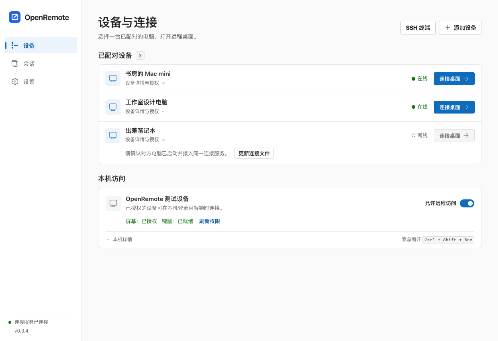
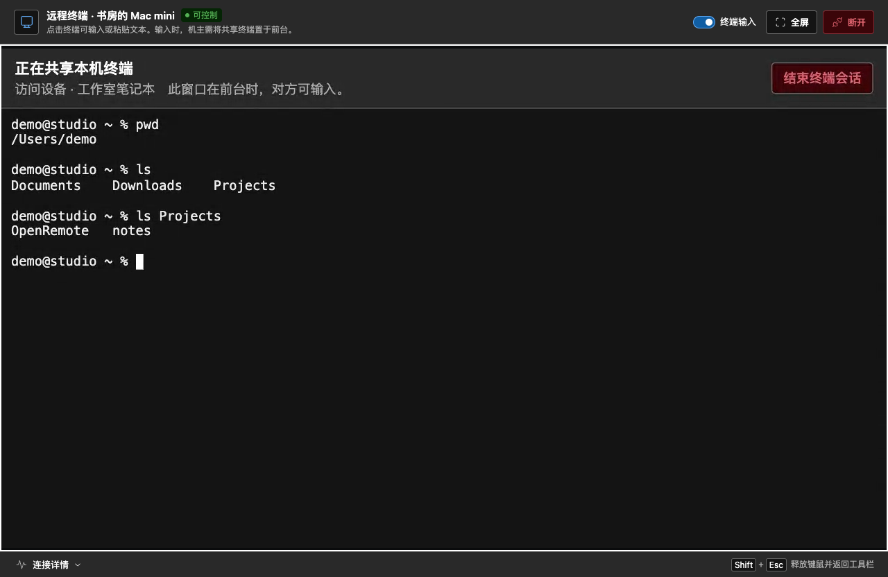

# OpenRemote

OpenRemote 支持 **Windows x64** 和 **Apple Silicon macOS**。已配对电脑可以共享整个桌面，也可以在机主确认后只打开一个双方可见的命令行窗口。对于已有 SSH 服务的主机，可以从应用打开系统 SSH 客户端直接登录。

## 下载

当前版本 **0.3.5**。[版本说明与 SHA-256 校验值](https://github.com/jialinlu/OpenRemote/releases/tag/v0.3.5)

| 平台 | 下载 |
| --- | --- |
| macOS · Apple Silicon | [下载 DMG 安装包](https://github.com/jialinlu/OpenRemote/releases/download/v0.3.5/OpenRemote-0.3.5-macos-arm64.dmg) |
| Windows · x64 | [下载 EXE 安装包](https://github.com/jialinlu/OpenRemote/releases/download/v0.3.5/OpenRemote-0.3.5-windows-x64-setup.exe) · [下载 ZIP 便携版](https://github.com/jialinlu/OpenRemote/releases/download/v0.3.5/OpenRemote-0.3.5-windows-x64-portable.zip) |

## 连接原理

**「连接桌面」和配对设备的「远程终端」都通过协调服务建立连接，再用 WebRTC 传输画面和输入。默认优先尝试两台电脑直连。** 下图以被控电脑点击「启动连接服务」、两端成功直连为例。


1. **两端先接入同一个协调服务。** 点击「启动连接服务」后，应用在本机运行协调服务，并通过 Cloudflare 隧道生成临时公网地址。另一台电脑从连接文件取得这个地址，因此使用临时入口无需自备公网服务器。这个入口只承载设备在线状态、配对请求、连接协商和会话质量统计等信令。双方也可以改用自建的 WSS 协调服务。
2. **两台电脑寻找可直达对方的线路。** 同一局域网内，画面和输入可以走内网。异地连接时，WebRTC 默认使用 Google 的 STUN 服务发现设备对外可见的地址，并尝试穿过路由器建立公网直连。直连成功后，桌面或终端画面从被控端发给控制端，键鼠输入沿同一条连接返回。
3. **复杂网络可以配置 TURN 中继。** 0.3.5 默认只配置 STUN。如果路由器或防火墙阻止直连，这组默认配置就无法建立会话。配置 TURN 后，设备可以经中继服务器转发加密的画面和输入，转发会占用该服务器的带宽。也可以勾选「仅使用 TURN 中继」来验证中继线路。[自建协调服务与 TURN 的部署方法](docs/DEPLOYMENT.md)

**查看本次会话走哪条线路**，请在会话窗口底部展开「连接详情」，查看「连接路径」。「点对点直连」涵盖局域网直连和跨公网直连，当前界面将两者显示为同一项。「TURN 中继」表示本次会话正在通过 TURN 服务器转发。

设备页右上角的「SSH 终端」使用系统 OpenSSH 连接你填写的主机和端口，线路由本机网络和 SSH 配置决定。[系统 SSH 的使用方法](#使用系统-ssh-终端)



## 从源码运行

需要 Node.js **22.12 或更高版本**、npm 及本机的 C++ 编译工具。macOS 使用 Xcode Command Line Tools。Windows 安装 Visual Studio Build Tools 的「使用 C++ 的桌面开发」工作负载，并在 **x64 Native Tools Command Prompt** 中执行以下命令。

```sh
git clone https://github.com/jialinlu/OpenRemote.git
cd OpenRemote
npm ci
npm run build:native
node scripts/prepare-tunnel.mjs
npm start
```

原生助手负责把获准的键鼠操作应用到被控电脑。`prepare-tunnel.mjs` 为当前平台准备临时公网入口所需的 cloudflared，并按项目固定的 SHA-256 核验下载内容。

## 使用配对设备的远程终端

两端升级到 **0.3.5 或更高版本** 并完成配对。机主打开「允许远程访问」，保持电脑已登录、解锁，允许这台设备控制本机。

1. 控制方在「设备与连接」找到对方，点击 **远程终端**。
2. 机主在 30 秒内核对设备名称和编号，选择 **允许本次终端**。双方随后看到同一个终端窗口。终端使用机主当前账户，在 macOS 上运行 zsh，在 Windows 上运行 Windows PowerShell。
3. 机主将共享终端放在前台，控制方点击画面后即可输入命令。机主切换到其他应用时，远端输入会暂停。勾选「仅允许观看」可以在保留画面的同时收回输入权限。
4. 任一方关闭会话窗口，或在命令行输入 `exit`，即可结束本次共享。下次连接需要重新确认。

这种连接复用已配对设备的网络连接，无需在目标机配置 SSH 服务、用户名或端口。只有专用终端窗口的画面会传给控制方。



## 使用系统 SSH 终端

在「设备与连接」页点击 **SSH 终端**，填写主机名或 IP 地址、端口（默认 22）和可选用户名，点击「打开终端」。也可以展开某台设备的「设备详情与授权」，为它单独记住 SSH 地址。密码、私钥口令和首次连接的主机指纹都在系统终端中处理。结束会话可在终端输入 `exit`。

目标主机需要运行 SSH 服务，且控制电脑能通过当前网络或 VPN 到达该地址。目标可以是没有图形桌面的 Linux 服务器。系统 SSH 使用独立的登录凭据，按本机 SSH 配置连接目标地址，整个过程无需 OpenRemote 配对、协调服务、STUN 或 TURN。Windows 需要安装系统可选功能 **OpenSSH 客户端**。[Windows OpenSSH 说明](https://learn.microsoft.com/en-us/windows-server/administration/openssh/openssh-overview)


## 第一次连接远程桌面

1. **在被控电脑上**，打开「让另一台电脑连接本机」，启动连接服务，导出 `.openremote` 连接文件并生成 8 位配对码。把文件和当前配对码交给要授权的人。配对码五分钟内有效，可以复制，也可以按分组朗读。
2. **在控制电脑上**，选择「控制另一台电脑」，导入文件，核对设备名称后输入配对码。连续数字和带空格的分组码都可以粘贴。
3. **回到被控电脑**，核对并确认请求，打开「允许远程访问」。macOS 首次使用需要在系统设置中授予屏幕录制和辅助功能权限。
4. **在控制电脑的设备列表**，点击对方的「连接桌面」。按 `Shift + Esc` 可以释放远端键鼠、返回本地工具栏。已配对设备再次使用时可直接从列表连接。

被控电脑需要保持登录、解锁且应用正在运行。临时服务重启后，公网地址可能变化，可以导出新连接文件更新入口。[使用与升级说明](docs/QUICKSTART.md)

## 共享时由机主掌控

共享提示窗显示正在访问的设备。勾选「仅允许观看」会释放已按住的键和鼠标按钮，保留画面并阻止对方继续输入。两端均为 0.3.3 或更高版本时，机主取消勾选后，控制方可重新开启键鼠；更早的控制端需要重新连接。「结束本次共享」保留下次访问授权，「结束并暂停远程访问」会同时关闭本机的访问开关。


## 构建与测试

完成上述依赖和原生组件准备后，在项目根目录运行：

```sh
npm run check
npm test
npm run pack
```

安装包输出到 `dist/openremote/`。默认生成当前平台的包。Windows 便携 ZIP 可用 `npm run pack -- --win zip --x64` 单独构建。macOS 构建使用本地 ad-hoc 签名，未经 Apple 公证。Windows 构建未配置商业签名。[Windows 构建说明](docs/WINDOWS-BUILD.md) · [双平台自动构建示例](docs/ci/build.yml)

验证覆盖配对终端的当次确认、窗口采集、输入权限和会话结束，以及系统 SSH 的地址校验、启动参数和本机配置存储。已在 macOS 本地回环环境验证系统 OpenSSH 的公钥认证、交互式输入和主机密钥变更拒绝。Windows 实机和跨网两机操作仍待验证。[验证记录](docs/VALIDATION.md) · [两机验收清单](docs/TESTING.md) · [渲染器测试](scripts/smoke-renderer.mjs)

## 源码目录

| 目录 | 内容 |
| --- | --- |
| `app/` | Electron 主进程、设备控制台、远控窗口和机主共享提示窗 |
| `shared/` | 设备身份、配对、会话权限、连接与键鼠事件处理 |
| `native/` | Windows 和 macOS 的 C++ 输入助手 |
| `server/`、`deploy/` | 协调服务、自建部署配置及 TURN 示例 |
| `scripts/`、`test/` | 构建、诊断、自动化测试与合成测试数据 |

## 许可证

项目原创源码采用 **Apache License 2.0**。Fluent 主题与图标、Electron 和其他第三方组件保留各自的许可。包名 `bridgedesk` 沿用于已有设备的数据兼容。[LICENSE](LICENSE) · [NOTICE](NOTICE) · [第三方组件](docs/THIRD-PARTY.md) · [安全说明](SECURITY.md)
