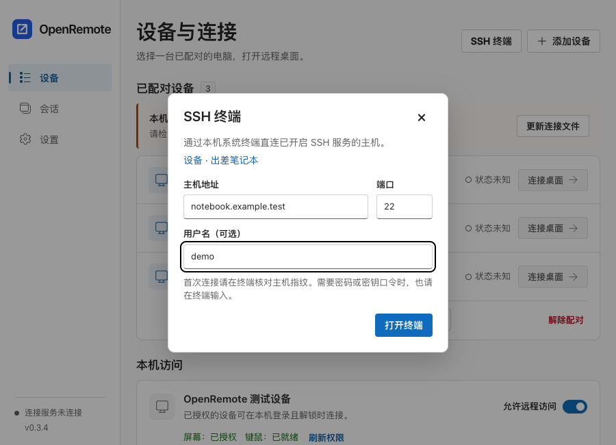

# OpenRemote

OpenRemote 是一款面向 **Windows x64** 和 **Apple Silicon macOS** 的远程桌面和 SSH 连接工具。需要画面时，可以连接已配对的桌面；只需要命令行时，可以直接打开系统 SSH 终端。共享桌面期间，机主可以随时收回键鼠或结束共享。


## 从源码运行

需要 Node.js **22.12 或更高版本**、npm 及本机的 C++ 编译工具。macOS 使用 Xcode Command Line Tools。Windows 安装 Visual Studio Build Tools 的「使用 C++ 的桌面开发」工作负载，并在 **x64 Native Tools Command Prompt** 中执行以下命令。

```sh
git clone https://github.com/jialinlu/OpenRemote.git
cd OpenRemote
npm ci
npm run build:native
node scripts/prepare-tunnel.mjs
npm start
```

原生助手负责把获准的键鼠操作应用到被控电脑。`prepare-tunnel.mjs` 为当前平台准备临时公网入口所需的 cloudflared，并按项目固定的 SHA-256 核验下载内容。

## 使用 SSH 终端

在「设备与连接」页点击 **SSH 终端**，填写主机名或 IP 地址、端口（默认 22）和可选用户名，点击「打开终端」。也可以展开某台设备的「设备详情与授权」，为它单独记住 SSH 地址。密码、私钥口令和首次连接的主机指纹都在系统终端中处理。结束会话可在终端输入 `exit`。

目标主机需要运行 SSH 服务，且控制电脑能通过当前网络或 VPN 到达该地址。目标可以是没有图形桌面的 Linux 服务器。桌面配对码和 SSH 登录是两套独立授权，OpenRemote 的临时连接入口只用于桌面信令。Windows 需要安装系统可选功能 **OpenSSH 客户端**。[Windows OpenSSH 说明](https://learn.microsoft.com/en-us/windows-server/administration/openssh/openssh-overview)



## 第一次连接远程桌面

1. **在被控电脑上**，打开「让另一台电脑连接本机」，启动连接服务，导出 `.openremote` 连接文件并生成 8 位配对码。把文件和当前配对码交给要授权的人。配对码五分钟内有效，可以复制，也可以按分组朗读。
2. **在控制电脑上**，选择「控制另一台电脑」，导入文件，核对设备名称后输入配对码。连续数字和带空格的分组码都可以粘贴。
3. **回到被控电脑**，核对并确认请求，打开「允许远程访问」。macOS 首次使用需要在系统设置中授予屏幕录制和辅助功能权限。
4. **在控制电脑的设备列表**，点击对方的「连接桌面」。按 `Shift + Esc` 可以释放远端键鼠、返回本地工具栏。已配对设备再次使用时可直接从列表连接。

被控电脑需要保持登录、解锁且应用正在运行。临时服务重启后，公网地址可能变化，可以导出新连接文件更新入口。默认尝试 WebRTC 直连，严格 NAT 或企业网络可能需要自建 TURN。[使用与升级说明](docs/QUICKSTART.md) · [自建信令服务与 TURN](docs/DEPLOYMENT.md)

## 共享时由机主掌控

共享提示窗显示正在访问的设备。勾选「仅允许观看」会释放已按住的键和鼠标按钮，保留画面并阻止对方继续输入。两端均为 0.3.3 或更高版本时，机主取消勾选后，控制方可重新开启键鼠；更早的控制端需要重新连接。「结束本次共享」保留下次访问授权，「结束并暂停远程访问」会同时关闭本机的访问开关。


## 构建与测试

完成上述依赖和原生组件准备后，在项目根目录运行：

```sh
npm run check
npm test
npm run pack
```

安装包输出到 `dist/openremote/`。默认生成当前平台的包。Windows 便携 ZIP 可用 `npm run pack -- --win zip --x64` 单独构建。macOS 构建使用本地 ad-hoc 签名，未经 Apple 公证。Windows 构建未配置商业签名。[Windows 构建说明](docs/WINDOWS-BUILD.md) · [双平台自动构建示例](docs/ci/build.yml)

0.3.4 的测试覆盖 SSH 地址与端口、终端启动、连接设置存储、窗口调用权限，以及原有的 WebRTC 桌面会话。已在 macOS 本地回环环境验证系统 OpenSSH 的公钥认证、交互式输入和主机密钥变更拒绝。Windows 实机和跨网两机操作仍待验证。[验证记录](docs/VALIDATION.md) · [两机验收清单](docs/TESTING.md) · [渲染器测试](scripts/smoke-renderer.mjs)

## 源码目录

| 目录 | 内容 |
| --- | --- |
| `app/` | Electron 主进程、设备控制台、远控窗口和机主共享提示窗 |
| `shared/` | 设备身份、配对、会话权限、连接与键鼠事件处理 |
| `native/` | Windows 和 macOS 的 C++ 输入助手 |
| `server/`、`deploy/` | 协调服务、自建部署配置及 TURN 示例 |
| `scripts/`、`test/` | 构建、诊断、自动化测试与合成测试数据 |

## 许可证

项目原创源码采用 **Apache License 2.0**。Fluent 主题与图标、Electron 和其他第三方组件保留各自的许可。包名 `bridgedesk` 沿用于已有设备的数据兼容。[LICENSE](LICENSE) · [NOTICE](NOTICE) · [第三方组件](docs/THIRD-PARTY.md) · [安全说明](SECURITY.md)
